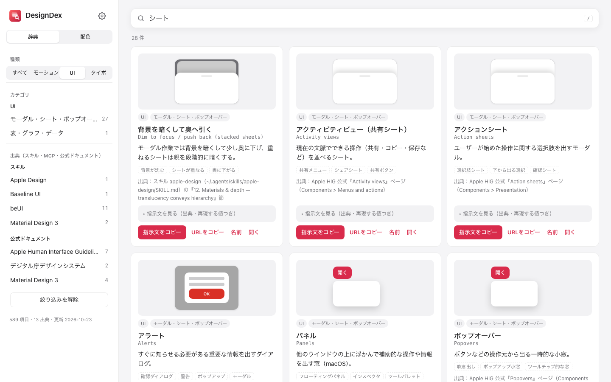
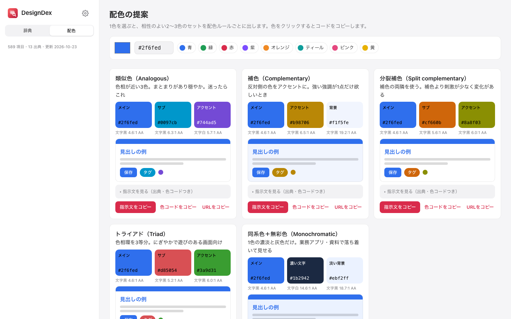
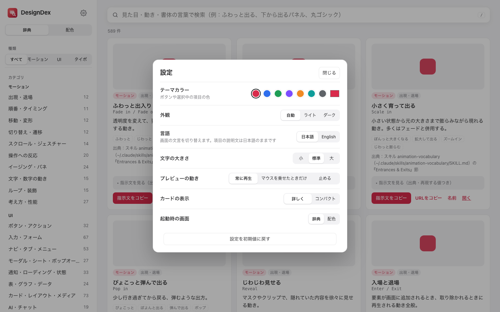

<p align="center"></p>

<h1 align="center">DesignDex</h1>

<p align="center">UI・モーション・配色・書体の「名前」と、AI にそのまま渡せるプロンプトを引く辞典<br>
A dictionary of names and ready-to-paste prompts for UI, motion, color and type.</p>

<p align="center"><a href="#日本語">日本語</a> · <a href="#english">English</a></p>



## 日本語

### できること

開発中に「下から出てくるパネル」「ふわっと出る動き」のように見た目しか言えず、AI への指示が曖昧になるのを防ぐ道具です。

| 機能 | 内容 |
|---|---|
| 辞典 | 標準で「基本」162項目（動き 93・UI 40・文字 29）。見た目の言葉で検索し、動くプレビューで確かめる。スキル・MCP・公式ドキュメント由来の項目は、各自が Claude Code / Codex から取り込んで足す |
| 出典つきプロンプト | 各項目に「どの公式ドキュメント／ライブラリの、どの節か」と再現に必要な数値を入れたプロンプト。公式ページの URL もコピーできる |
| 配色の提案 | 1色を選ぶと、配色ルール（類似色・補色・分裂補色・トライアド・同系色）ごとに相性のよい3色セットを出す。コントラスト比（WCAG）つき |
| 設定 | テーマカラー・外観（自動／ライト／ダーク）・言語（日本語／English）・文字の大きさ・プレビューの動き・カードの表示・ボタンの表示（アイコン／文字／両方）・起動時の画面・スキルの取り込み・使い方 |

収録元: [Apple Human Interface Guidelines](https://developer.apple.com/design/human-interface-guidelines)、[Material Design 3](https://m3.material.io)、[デジタル庁デザインシステム](https://design.digital.go.jp)、[beUI](https://beui.dev)、[Google Fonts](https://fonts.google.com)、MDN、各種デザイン系 Agent Skill。

| 配色の提案 | 設定 |
|---|---|
|  |  |

### 使い方

**Web 版（Windows・Linux・スマホを含むすべての環境）**
GitHub Pages で公開しているページを開くだけです。インストールは要りません。

**Mac アプリ（macOS 14 以降・Intel と Apple Silicon の両方）**
1. [Releases](../../releases) から `DesignDex-macOS.zip` をダウンロードして展開し、`DesignDex.app` を「アプリケーション」に入れる
2. 署名していない配布のため、初回だけ Finder で `DesignDex.app` を右クリック →「開く」→「開く」（または「システム設定 → プライバシーとセキュリティ」の「このまま開く」）

ショートカット: `⌘F` 検索 ／ `⌘1` 辞典 ／ `⌘2` 配色 ／ `⌘,` 設定 ／ `⌘R` 読み込み直す ／ `⌘O` 辞典のフォルダを選ぶ
Web 版とアプリの違いは、保存先（Web はそのブラウザ、アプリはアプリ内）と、画面から色を拾うスポイト（アプリだけ）の2点です。ログインは不要で、取り込んだ項目・お気に入り・設定はその端末から外に出ません。

### ソースから動かす

必要なもの: Python 3.11 以降（標準ライブラリだけで動きます）。Mac アプリを作るときは加えて macOS 14 以降と Xcode Command Line Tools（`xcode-select --install`）。

```bash
python3 tools/build.py --public   # data/ を検証して web/dist/catalog.js を作る
open web/index.html               # Windows は start、Linux は xdg-open。サーバーは不要
python3 tools/test_build.py       # 検証ルールのテスト
bash mac/build_app.sh             # Mac アプリ（mac/build/DesignDex.app）。--install で /Applications に入れる
```

### 自分のスキルを取り込む（Claude Code / Codex）

アプリを初めて開くと案内が出ます。あとからは、右上の歯車 →「自分のスキルを取り込む」でいつでも始められます。

1. アプリの［プロンプトをコピー］を押す
2. ターミナルで `claude`（または `codex`）を起動し、貼り付けて Enter。AI が `~/.claude/skills`・`~/.agents/skills` などのデザイン系スキルを読み、`~/Downloads/designdex-import.json` を書き出す
3. アプリでそのファイルを選ぶ（枠に置くか、押して選ぶ）

取り込んだ項目はこの端末（ブラウザ／アプリ）に保存され、どこにも送られません。同じ手順はスキル [integrations/designdex-import](integrations/designdex-import/SKILL.md) としても使えます（`~/.claude/skills/` か `~/.agents/skills/` に置けば `/designdex-import`・`$designdex-import` で実行）。

### 自分用の項目を足す

- 項目の書式は [docs/ENTRY_SPEC.md](docs/ENTRY_SPEC.md)、使えるプレビューは [docs/DEMOS.md](docs/DEMOS.md)
- 公開データは `data/entries/`、自分だけの項目は `data/local/entries/`（Git 管理外）に置く。`python3 tools/build.py` は両方を、`--public` は公開データだけを使う
- Mac アプリで自分の項目も見るには、メニュー「ファイル → 辞典のフォルダを選ぶ…」でこのリポジトリのフォルダを選ぶ
- Claude Code / Codex を使う場合、`python3 tools/build.py --sources` で「導入済みだが未登録のスキル・MCP」を一覧できる

### フォルダ構成

```
web/        画面（HTML・CSS・JS）。web/dist/ はビルドで作られる
data/       辞典のデータ（entries/ が公開、local/ が個人用）
tools/      ビルド・検証・beUI 見本の撮影（撮影だけ Playwright が必要）
mac/        Mac アプリ（SwiftUI + WKWebView、web/ を同梱）
docs/       書式・デモ一覧・スクリーンショット
.github/    テスト・GitHub Pages 公開・Mac アプリの配布
```

### 権利表記

コードは [MIT License](LICENSE)。収録した説明文は各公式ドキュメントを要約したもので、出典ページへのリンクを付けています。商標・画像などの扱いは [THIRD_PARTY.md](THIRD_PARTY.md) を参照してください。

## English

DesignDex helps you name what you see — "the panel that slides up", "that springy pop" — so you can give AI coding tools precise instructions.

- **Dictionary**: ships with 162 "Basics" (93 motion, 40 UI, 29 type) with live previews, searchable by everyday words. Items from skills, MCP servers and official docs are added by each user by importing from Claude Code / Codex.
- **Sourced prompts**: every entry has a prompt that cites the exact official page or library section and the values needed to reproduce the preview, plus a copyable official URL.
- **Color suggestions**: pick one color and get 3-color sets for each harmony rule, with WCAG contrast ratios.
- **Settings**: theme color, appearance, language (interface text; entry descriptions are Japanese), text size, preview motion, card layout, start screen.

**Import your own skills (Claude Code / Codex)**: a guide opens on first launch; later use Settings (gear, top right) → Import your skills. (1) Copy the import prompt, (2) start `claude` or `codex` in a terminal and paste it — the AI reads your installed design skills and writes `~/Downloads/designdex-import.json`, (3) choose that file in DesignDex. Imported items stay on your device. The same steps ship as a skill in [integrations/designdex-import](integrations/designdex-import/SKILL.md).

**Web**: open the GitHub Pages site — works on any OS and browser.
**macOS app** (macOS 14+, universal): download `DesignDex-macOS.zip` from Releases, move the app to Applications, then right-click → Open the first time (the app is not notarized).

Build from source: Python 3.11+ only (`python3 tools/build.py --public`, then open `web/index.html`). For the Mac app, add Xcode Command Line Tools and run `bash mac/build_app.sh`. Entry format: [docs/ENTRY_SPEC.md](docs/ENTRY_SPEC.md). Licensed under MIT; see [THIRD_PARTY.md](THIRD_PARTY.md) for trademarks and third-party content.
